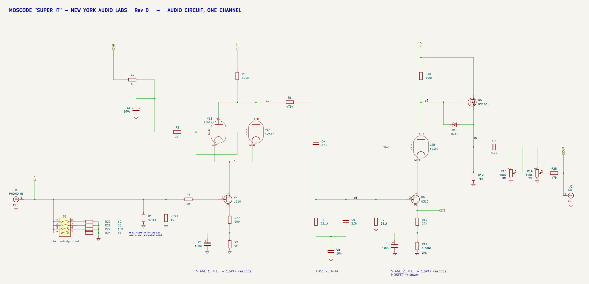
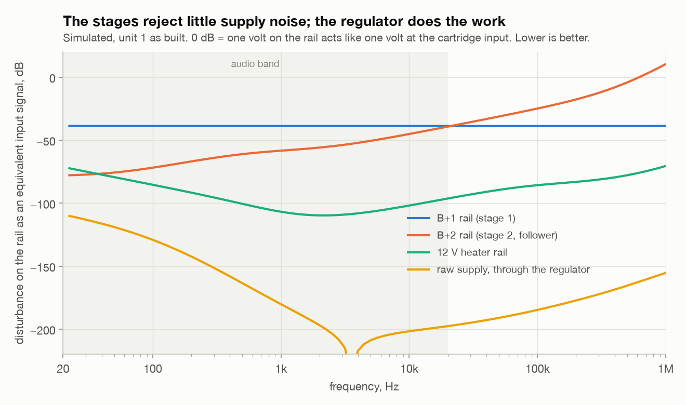
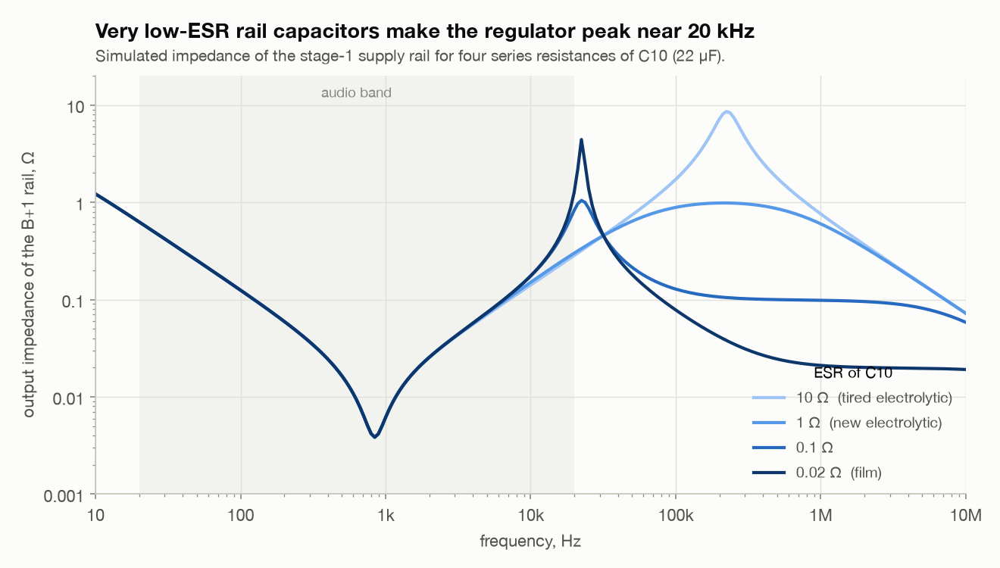

# Moscode (New York Audio Labs) SuperIt phono preamp

A reverse-engineered model of the NYAL "SuperIt" hybrid phono preamplifier
(George Kaye, about 1985): a KiCad schematic that simulates, a scripted SPICE
model, and a study of what limits its linearity and how to improve it.

**Short version**

- Each stage is a JFET with a 12AX7 triode on top (a cascode) and a 100 kΩ load.
  One unbypassed source resistor per stage sets that stage's gain and
  linearity: **R27** in stage 1 and **R19** in stage 2. A second, bypassed
  resistor per stage sets the bias: R2 and the trimmer R11. Every change
  recommended here is a change to one of those resistors.
- Unit 1 (the complete one) is a low-gain build: R27 is 909 Ω, not the 10 Ω seen
  on another board. As built, the model gives 58 dB gain at 1 kHz, 6 nV/√Hz
  input noise, and 0.31 % distortion at 5 mV input, nearly all of it second
  harmonic from stage 2.
- Changing **R19 from 274 Ω to 1.5 kΩ** and re-trimming R11 cuts distortion
  about fifteen-fold (0.31 % to 0.02 % at 5 mV) and brings the gain down to
  48 dB, which suits a moving-magnet cartridge. Noise does not change.
- For a low-output moving-coil cartridge, **R27 is the noise knob**: 22 to 100 Ω
  (with R2 raised by the same amount) takes the noise from 6 to between 2.2
  and 2.6 nV/√Hz. A 2SK170/LSK170 input JFET takes it to 1.4 nV/√Hz, but only
  with R2 re-selected.
- The RIAA equalisation is within ±0.5 dB as built. **R7 from 22.1 kΩ to
  24.3 kΩ** brings it within ±0.2 dB.
- The numbers come from a model in which several parts are still estimates.
  A few measurements on the real unit would pin it down; see
  [What to measure](#what-to-measure).

The unit runs from a rectified 220 V winding: about 310 V DC on the reservoir
capacitor and about 250 V on the plate supplies. Unplug it and discharge C18
before touching the board.

## Contents

| Path | What it is |
|---|---|
| `sources/schematic-scan-1.jpg`, `schematic-scan-2.webp` | Two scans of the same Rev D drawing. Topology and designators only: the drawing carries no values and no transistor types. |
| `sources/moscode-1.webp` | Board photo found on line: stock unit, board rev E. |
| `sources/moscode-2.jpg` | Board photo found on line: modified unit. |
| `sources/IMG_4981` to `IMG_4985` | Unit 1: complete rev E board dated 2-86. |
| `sources/IMG_4986` to `IMG_4988` | Unit 2: earlier board (593-008004, dated 38-85), partly stripped. |
| `sources/IMG_4993` to `IMG_5001` | Unit 1 close-ups: C4, R7, the rail film capacitors, R9, R11, C8 and C1. |
| `readings/` | Enlarged crops of the parts whose markings and colour bands were read, with the reading written on each. |
| `kicad/` | KiCad project `superit.kicad_pro`. Root sheet: power supply and test sources. `channel.kicad_sch`: one audio channel, used twice. `superit.lib`: SPICE models. |
| `kicad/superit-schematic.pdf` | The whole schematic as a PDF: power supply and test fixture, left channel, right channel. |
| `kicad/channel.png` | The audio circuit of one channel, shown below. |
| `sim/circuit.py` | The parts list, the single source of every value. Each part is tagged K (known), P (read from a photo) or E (estimate), with a note. |
| `sim/*.py` | Simulation scripts; see [Running the model](#running-the-model). |
| `sim/plots/` | The charts below. |
| `sim/out/` | Results: `study.json`, `extras.json`, `psu.json` and the matching `.log` files. The scripts also write their decks and raw tables here; those are not kept in the repository. |

## The circuit



The full schematic, with the power supply, is in
[kicad/superit-schematic.pdf](kicad/superit-schematic.pdf). Values on it are
the ones in the model; R11 is shown at its trimmed setting, and R3 and R8 are
wire links.

Signal path, one channel (designators from the Rev D drawing):

1. **Input.** J1, with R1 (47.5 kΩ) to ground and four switched loading
   resistors R20 to R23 on DIP switch S1 for moving-coil cartridges. R8 is in
   series with the gate of Q7.
2. **Stage 1.** Q7, a U310 JFET, with both halves of a 12AX7 (V1) in parallel
   on top of it as a cascode. The triode grids sit on the +12 V heater rail
   through R4 and R3, decoupled by C3, which holds the JFET drain at about 13 V.
   The plate load is R5 (100 kΩ) from B+1. In the source: R27 unbypassed, then
   R2 bypassed by C1.
3. **RIAA network**, passive, between the stages: R6 (475 kΩ) in series, C4
   coupling, then R7 in parallel with C5 (3300 pF), that pair in series with C6
   (0.01 µF) to ground. R9 (681 kΩ) is the gate leak of Q6 and is part of the
   network.
4. **Stage 2.** Q6, another U310, with one half of the shared 12AX7 (V2) as the
   cascode and R10 (100 kΩ) from B+2. In the source: R19 unbypassed, then the
   BIAS trimmer R11 (5 kΩ) bypassed by C8.
5. **Output.** Q5, a BSS101 MOSFET source follower loaded by R12 (75 kΩ), then
   C7, the balance pot R13 (100 kΩ), the volume pot R14 (100 kΩ) and R25
   (475 Ω) to J2.

The gain of each stage is close to `R_load / (R_unbypassed + 1/gm)`, with 1/gm
about 235 Ω for a U310 at 1 mA. As built that is 100k / (909 + 235), or 39 dB,
in stage 1; the RIAA network loses 26 dB at 1 kHz; and stage 2 gives 45.5 dB.
Stage 2 therefore sees the larger signal and has the lighter degeneration,
which is why it produces most of the distortion.

**Power supply.** 220 VAC, bridge D1 to D4, reservoir C18. R18 and two zeners
(D5, D6) feed a Darlington (Q1, Q2) that makes a pre-regulated rail. The
LF353 (IC2) floats on that rail from zener D9 and R15, and drives two MOSFET
followers (Q3, Q4) that copy a filtered reference (R17/R16, C14) to B+1 and
B+2. Heaters: 14.5 VAC, bridge, C20, a 12 V regulator, three 12AX7 heaters in
parallel. The op-amp is in the supply only, not in the signal path.

## Where the values come from

The drawing has no values, so every value was read from photographs or
estimated. `sim/circuit.py` has the full list with a note on each part. The
readings that matter most:

| Part | Unit 1 (rev E, 2-86) | Unit 2 (38-85) | Web photos | In the model |
|---|---|---|---|---|
| Q7, Q6 | U310 metal can (Q7 marking clear) | U310 (Q6 marking clear) | unmarked cans | U310 |
| R27 | **909 Ω** (clear) | not found | 10 Ω | 909 Ω |
| R2 | 1.00 kΩ | not legible | 1.00 kΩ | 1.00 kΩ |
| R19 | 274 Ω | 274 Ω | 274 Ω | 274 Ω |
| R11 | 5 kΩ trimmer (marked 502) | trimmer, value not visible | same | set for 1 mA (about 1.84 kΩ) |
| R5 | 100 kΩ | looks like 150 kΩ 2 % | 100 kΩ | 100 kΩ |
| R10 | 100 kΩ | 100 kΩ | 100 kΩ | 100 kΩ |
| R6 | 475 kΩ | 475 kΩ | 475 kΩ (tentative) | 475 kΩ |
| R7 | **22.1 kΩ 1 %** (close-up) | looks the same | not legible | 22.1 kΩ |
| R9 | **681 kΩ 1 %** (close-up) | not legible | not legible | 681 kΩ |
| C5, C6 | 3300 pF 1 %, 0.01 µF 2 % | same, markings clear | same | as marked |
| C4 | WIMA MKP10 0.1 µF 400 V | 0.1 µF 400 V | red film box | 0.1 µF |
| C8, C1 | **100 µF 16 V** (C8 marking clear; C1 is the same can, value read on the unit) | not legible | not legible | 100 µF both |
| R3, R8 | 0 Ω links | real resistors, about 22 Ω | 0 Ω links | links |
| R4 | 1.00 kΩ | 475 kΩ in that position | 1 kΩ | 1.00 kΩ |
| Q5 | BSS101 | TO-92, not read | TO-92 | BSS101-class model |
| R12 | 75 kΩ power resistor | 75 kΩ | not legible | 75 kΩ |
| Q3, Q4 | VN0220N2 (TO-39) | TO-92 parts | TO-92 | generic 200 V MOSFET |
| IC2 | LF353N | **socket empty** | LF353N | LF353 model |
| C18 | 390 µF 350 V, dated 2024 (a replacement) | **missing** | original can | 390 µF |
| C14 | red film box | WIMA 1.0 µF 250 V | red film box | 1 µF |
| Rail film capacitors (C11, C13 on the drawing) | WIMA MKP10 0.22 µF 250 V | not read | red film boxes | 0.22 µF |
| C21 | not fitted | a small axial part is fitted | not fitted | open |
| Pots | 100 kΩ MN, 100 kΩ dual | same | same | 100 kΩ |

Still estimates: C3 and C7 (values not legible), the zeners D5, D6, D9 and
D10, the loading resistors R20 to R23, and most of the power-supply
resistors. B+ is therefore an estimate too: 247 V in the
model. It cannot be much higher, because C14 and the rail film capacitors sit
at B+ and are rated 250 V.

Four points about these readings:

- **R7 is 22.1 kΩ, not 2.21 kΩ.** Its bands are red, red, brown, then a
  multiplier band, then a brown tolerance band set apart. The multiplier
  band looks close to brown in the photo, which would make 2.21 kΩ. Sampled
  against the true brown bands on the same resistor it is red, which makes
  22.1 kΩ. The circuit agrees: one corner of the RIAA curve is set by
  R7 × (C5 + C6), which must be near 318 µs. 22.1 kΩ gives 294 µs; 2.21 kΩ
  would give 29 µs. A meter across R7 settles it; see
  [What to measure](#what-to-measure).

- **R27 explains the different boards.** With R27 = 909 Ω the model gives 58 dB;
  with 10 Ω and R2 re-selected it gives 71 dB. Owners report that the factory
  offered a 72 dB gain upgrade, and reviewers found the unit quiet with
  higher-output cartridges and noisy with low-output moving coils. All of that
  is consistent with R27 being the factory's gain option. This is my inference,
  not a documented fact.
- **The U310s must be low-pinch-off samples.** The data sheet allows a pinch-off
  of 2.5 to 6 V. With 909 Ω + 1.00 kΩ in the source, only a part near 2.5 V runs
  at about 1 mA, which is what owners report (100 V across R5). The model uses
  that corner (2.6 V, 24 mA Idss). A centre-of-range part would draw 1.7 mA,
  drop the plate to 78 V and push the triode to the edge of grid current, so
  this is worth checking on the unit.
- **Unit 2 is an earlier board and does not fully match the Rev D drawing.**
  R4 = 475 kΩ and R5 = 150 kΩ suggest a different arrangement around V1. Trace it
  before assuming the model applies. To run again it needs at least an LF353
  and a reservoir capacitor.

## Results: unit 1 as built

All figures are simulated: left channel, 10 Ω source unless stated, 100 kΩ and
200 pF load, volume at maximum.

| Quantity | Value |
|---|---|
| Gain at 1 kHz | 58.2 dB (stage 1 with EQ 12.7 dB, stage 2 45.5 dB) |
| Output for 5 mV at 1 kHz | 4.1 V rms |
| Input noise at 1 kHz | 6.0 nV/√Hz |
| S/N, A-weighted, re 5 mV, moving-magnet source (1 kΩ + 500 mH) | 78.9 dB |
| S/N, A-weighted, re 0.5 mV, 10 Ω source | 62.9 dB |
| THD at 1 kHz | 0.031 % at 0.5 mV, 0.31 % at 5 mV, 1.25 % at 20 mV |
| Input level for 1 % THD | 16 mV |
| RIAA error re 1 kHz | +0.3 to +0.45 dB from 20 to 200 Hz, +0.5 dB from 10 to 20 kHz |
| Raw-supply ripple to output | −47 dB at 60 Hz, −62 dB at 120 Hz |
| Crosstalk L to R | −75 dB at 100 Hz, below −100 dB above 1 kHz |

DC operating point in the model: B+ 247 V; stage-1 plate 137 V (109 V across
R5, 1.09 mA); Q7 drain 12.9 V, source 2.09 V, 1.09 V across R2; stage-2 plate
147 V (100 V across R10 as trimmed); Q6 source 2.11 V; Q5 source 145 V at
1.9 mA.

What limits it:

- **Distortion is second harmonic from stage 2**, in proportion to level. A
  JFET at 1 mA is a square-law device, and stage 2 has only 274 Ω of
  degeneration for a signal that stage 1 has already amplified.
- **Noise is set by R27.** 909 Ω of unbypassed resistance in the input source
  lead is 3.9 nV/√Hz by itself, and the low stage-1 gain lets the RIAA network
  and stage 2 add as much again. For a moving-magnet cartridge this does not
  matter: the cartridge's own noise dominates (78.9 dB against 80.9 dB for the
  quietest variant).
- **The volume pot costs treble.** At full volume there is no loss. Turned
  down, the pot's output resistance (up to 25 kΩ) works against the cable and
  amplifier input capacitance. With 58 dB of gain the pot will usually be well
  down.


- **The RIAA equalisation is within ±0.5 dB, and R7 accounts for the
  error.** It is a little low: R7 × (C5 + C6) is 294 µs against the standard
  318 µs, which leaves the response 0.3 to 0.5 dB high on both sides of
  1 kHz. With R7 = 24.3 kΩ the error is within ±0.2 dB from 20 Hz to 20 kHz
  (the dashed line). What is left is mostly at 20 Hz, where the 100 µF
  source bypass capacitors C1 and C8 start to lose gain.


## Results: changes compared

| | Change from unit 1 as built | Gain, 1 kHz | Noise, 1 kHz | S/N(A) re 0.5 mV | THD at 0.5 mV | THD at 5 mV |
|---|---|---|---|---|---|---|
| A | none | 58.2 dB | 6.0 nV/√Hz | 62.9 dB | 0.031 % | 0.31 % |
| B | R27 10 Ω, R2 1.9 kΩ, C1 470 µF (the high-gain build) | 71.5 dB | 2.1 | 72.1 dB | 0.13 % | 1.3 % |
| C | R19 1.5 kΩ, R11 re-trimmed | 47.8 dB | 6.1 | 62.4 dB | 0.002 % | 0.020 % |
| D | B and C together | 61.1 dB | 2.1 | 72.0 dB | 0.016 % | 0.16 % |
| E | D with 2SK170 at Q7, R27 22 Ω, R2 about 310 Ω, C1 1000 µF | 70.1 dB | 1.36 | 76.1 dB | 0.033 % | 0.33 % |
| F | C8 removed, nothing else | 45.2 dB | 6.1 | 62.2 dB | 0.001 % | 0.010 % |

S/N re 5 mV with a moving-magnet source is 78.6 to 80.9 dB for all six. The
RIAA error is the same in all six above 100 Hz. C1 goes up when R27 comes
down because the lower R27 moves the bypass corner up: with 100 µF and
R27 = 10 Ω the response would be 0.5 dB lower at 20 Hz.


**R19, the stage-2 knob** (stage 1 as built; R11 re-trimmed to keep 1 mA):

| R19 | R11 after trim | Gain | THD at 5 mV | Output at 5 mV |
|---|---|---|---|---|
| 274 Ω | 1.84 kΩ | 58.2 dB | 0.31 % | 4.1 V |
| 560 Ω | 1.55 kΩ | 54.4 dB | 0.12 % | 2.6 V |
| 1.0 kΩ | 1.11 kΩ | 50.7 dB | 0.047 % | 1.7 V |
| 1.5 kΩ | 0.61 kΩ | 47.8 dB | 0.020 % | 1.2 V |
| 2.0 kΩ | 0.11 kΩ | 45.6 dB | 0.011 % | 0.95 V |

**R27, the stage-1 knob** (U310 at Q7; R2 re-selected so that R27 + R2 stays
near 1.91 kΩ; C1 = 470 µF below 909 Ω; stage 2 with R19 = 1.5 kΩ):

| R27 | R2 | Gain | Noise, 1 kHz | S/N(A) re 0.5 mV | THD at 0.5 mV |
|---|---|---|---|---|---|
| 909 Ω | 1.00 kΩ | 47.8 dB | 6.1 nV/√Hz | 62.4 dB | 0.002 % |
| 470 Ω | 1.44 kΩ | 51.9 dB | 4.3 | 65.6 dB | 0.003 % |
| 220 Ω | 1.69 kΩ | 55.7 dB | 3.2 | 68.3 dB | 0.005 % |
| 100 Ω | 1.81 kΩ | 58.4 dB | 2.6 | 70.1 dB | 0.008 % |
| 47 Ω | 1.86 kΩ | 59.8 dB | 2.3 | 71.1 dB | 0.012 % |
| 22 Ω | 1.89 kΩ | 60.6 dB | 2.2 | 71.7 dB | 0.014 % |
| 10 Ω | 1.90 kΩ | 61.1 dB | 2.1 | 72.0 dB | 0.016 % |

With R19 left at 274 Ω the gains are 10.4 dB higher and the distortion is
8 to 15 times higher.


## Power supply across the audio band and above

From `sim/psu.py`. Several supply parts are estimates (C10, C12, C16, C17, the
zeners), so read these as the behaviour of this kind of regulator, not as
measurements of the unit. Rail capacitors here are 22 µF with 1 Ω series
resistance (ESR), which is what a new 350 to 450 V electrolytic of that size
has.

| Frequency | B+1 rail impedance | Raw ripple to B+ | B+1 as an equivalent input | B+2 as an equivalent input | Raw supply as an equivalent input |
|---|---|---|---|---|---|
| 20 Hz | 0.63 Ω | −70 dB | −39 dB | −78 dB | −109 dB |
| 60 Hz | 0.21 Ω | −82 dB | −39 dB | −75 dB | −121 dB |
| 120 Hz | 0.10 Ω | −93 dB | −39 dB | −71 dB | −132 dB |
| 1 kHz | 0.006 Ω | −141 dB | −39 dB | −58 dB | −180 dB |
| 10 kHz | 0.15 Ω | −163 dB | −39 dB | −45 dB | −202 dB |
| 20 kHz | 0.30 Ω | −162 dB | −39 dB | −39 dB | −198 dB |
| 100 kHz | 0.89 Ω | −163 dB | −39 dB | −25 dB | −185 dB |
| 1 MHz | 0.60 Ω | −171 dB | −39 dB | +10 dB | −155 dB |

"As an equivalent input" means: a disturbance on that rail has the same effect
on the output as an input signal that many dB smaller.



- **The stages themselves reject very little.** A cascode with a resistor load
  lets its plate follow the supply. Noise on B+1 reaches the stage-1 plate
  nearly unattenuated, so referred to the input it is reduced only by the
  stage-1 gain: 39 dB as built, 52 dB in the high-gain build, at every
  frequency. Noise on B+2 reaches the output at unity gain up to several
  hundred kilohertz.
- **The regulator makes up for it.** Three things act in series: the zener and
  Darlington pre-regulator, the reference filter (R17/R16 with C14, a 3 Hz
  corner), and the op-amp loop. Reservoir ripple of up to about 0.1 V rms at 120 Hz
  comes out as 25 nV referred to the input, 106 dB below a 5 mV signal.
- **Regulator noise is not a limit.** The LF353's own noise (about
  18 nV/√Hz, not in the model) lands on B+1 and is worth 0.2 nV/√Hz at the
  input, against 6 nV/√Hz for the amplifier.
- **The weak region is below 100 Hz.** There the two rails move together,
  because the reference follows the pre-regulator rail and only C14 filters
  it. The rail impedance rises to 0.6 Ω at 20 Hz. This sets both the ripple
  figure and the low-frequency crosstalk (−55 dB at 20 Hz, −75 dB at 100 Hz).
  Raising C14 from 1 µF to 4.7 µF improves ripple rejection by 13 dB and
  crosstalk to −68 dB at 20 Hz and −88 dB at 100 Hz. Raising C17 to 100 µF
  gives another 10 dB of ripple rejection at 60 Hz.
- **Above the audio band** the loop has run out of gain (it crosses over at
  roughly 25 kHz) and the rail impedance is the ESR of C10 and C12. The
  0.22 µF film capacitors beside them take over only above about 700 kHz. The
  −160 dB raw-supply figures at high frequency will not be met on a real
  board: stray coupling and wiring set the floor there, and that is how
  rectifier switching noise gets in.



- **The series resistance of C10 and C12 is what keeps the loop damped.** With
  0.3 Ω or more there is no peak. With 0.1 Ω the B+1 rail peaks at 1 Ω near
  22 kHz. With a film capacitor (0.02 Ω) it peaks at 4.4 Ω at 22 kHz (2.6 Ω at
  30 kHz on B+2) and rings for about half a millisecond after a load step. It
  stays stable in every case tried. A larger capacitor lowers the peak: 100 µF
  at 0.1 Ω peaks at 0.27 Ω at 11 kHz. A tired capacitor (10 Ω) gives no peak but
  leaves the rail at 8 Ω between 200 and 300 kHz.
- The audible consequence of that peak is small, because the signal currents
  drawn from the rails are small (tens of microamps to 0.2 mA); by hand
  calculation the worst case is crosstalk of about −80 dB at the peak
  frequency. There is still nothing to gain from very low-ESR parts there.
- The zener model has a lower dynamic impedance than real 130 V zeners at
  1 mA, so the real pre-regulator probably rejects ripple less well at 60 and
  120 Hz than the table shows, and depends more on C17.

## Recommendations

In order of value for effort. Items 2 to 4 need two resistors per channel and
a meter. Item 7 needs one resistor per channel.

1. **Measure first.** The checks in [What to measure](#what-to-measure) tell
   you whether the model's operating point is right for your unit.

2. **Stage 2: change R19 from 274 Ω to 1.5 kΩ**, 1 % metal film, both
   channels, and re-trim R11 for the same voltage across R10 as before. Leave
   C8 in place. Result: distortion down about fifteen-fold, gain 48 dB, and
   1.2 V out for 5 mV in, so the volume control runs nearer the top, where it
   loses no treble. Pick another row of the R19 table if you want more gain.
   Removing C8 instead (variant F) gives a similar result with no new parts,
   but then the gain depends on where each trimmer ends up, which differs
   between channels when the JFETs differ.

3. **Stage 2 bias: trim R11 for about 80 V across R10 instead of 100 V**, or
   try a 12AT7 in the V2 socket. Reason: at 1 mA the V2 triode sits at only
   −0.73 V grid to cathode, close to where a 12AX7 starts to draw grid current.
   The standard tube model has no grid current. With a representative
   grid-current law added, variant C's distortion at 5 mV rises from 0.02 % to
   0.24 %; at 0.8 mA (−1.04 V) it falls back to 0.013 %. A 12AT7 sits at
   −2.2 V with the same gain and distortion. How much grid current your V2
   draws depends on the individual tube, so treat this as a hedge. It also
   suggests that V2 is the socket where swapping tubes changes the sound most.

4. **Stage 1: choose R27 for the cartridge.** Always change R2 in the opposite
   direction so that R27 + R2 stays the same and the current does not move.
   If you lower R27 below about 220 Ω, raise C1 from 100 µF to 470 µF to
   keep the response at 20 Hz.
   - Moving magnet, about 5 mV: leave R27 at 909 Ω. Lower values add
     distortion and gain you do not need, for at most 2 dB of S/N.
   - High-output moving coil, about 2 mV: R27 220 to 470 Ω.
   - Low-output moving coil, 0.3 to 0.5 mV: R27 22 to 100 Ω and R2 about 1.8 to
     1.9 kΩ, with R19 = 1.5 kΩ (variant D): 58 to 61 dB, 2.2 to 2.6 nV/√Hz,
     70 to 72 dB S/N re 0.5 mV.

5. **For the quietest moving-coil stage, fit a 2SK170 or LSK170 at Q7**
   (variant E): 1.4 nV/√Hz and 76 dB S/N re 0.5 mV. It needs R27 22 to 47 Ω,
   R2 re-selected (about 300 Ω; aim for 100 to 110 V across R5) and C1 raised
   to 1000 µF. Do not fit one without re-selecting R2: with the present
   909 Ω + 1.00 kΩ it would run at 0.23 mA and starve the triode. Check the
   pinout; it differs from the U310 can.

6. **Volume pot and cable.** At −6 dB the 100 kΩ pot loses 1.5 dB at 10 kHz
   and 4.2 dB at 20 kHz into 500 pF. Keep the cable short, or replace the
   balance and volume pots with 25 kΩ parts: the loss at 20 kHz falls to
   0.65 dB and the follower drives them without added distortion. 10 kΩ pots
   reduce it to 0.15 dB but lose 0.5 dB at 20 Hz unless C7 is larger than the
   4.7 µF I assumed.

7. **RIAA trim: R7 from 22.1 kΩ to 24.3 kΩ.** This takes the error from
   ±0.5 dB to within ±0.2 dB from 20 Hz to 20 kHz. The largest error left is
   −0.17 dB at 20 Hz. C1 and C8 (100 µF 16 V) are 1980s parts and due for
   replacement anyway; fitting 220 µF in both when you do brings the error
   within ±0.1 dB. Confirm R7 with a meter first.

8. **Leave C21 unfitted.** On the drawing it links the two Q6 sources. With
   220 pF there, channel separation falls to 54 dB at 10 kHz and 48 dB at
   20 kHz. Unit 2 has a part in that position.

9. **When replacing supply capacitors**, use ordinary electrolytics for C10
   and C12, not film or polymer types; if you do fit film, add 0.5 to 1 Ω in
   series. Raise C14 (the reference filter) to 4.7 µF film and C17 to 47 or
   100 µF: together these improve ripple rejection and low-frequency channel
   separation by 13 dB or more. See
   [Power supply](#power-supply-across-the-audio-band-and-above).

Not worth doing: changing the op-amp. It regulates the supply, and the model
shows 82 dB of rejection from the raw supply to B+ at 60 Hz with the LF353.
The small electrolytics carry 1984 date codes; replacing C3, C22 and the
supply capacitors like for like is ordinary maintenance and was not
simulated.

## What to measure

With the unit on, these low-voltage points give the two stage currents
directly:

| Measure | Model | Meaning |
|---|---|---|
| DC volts across R2 (1.00 kΩ) | 1.09 V | Stage-1 current in mA. Above about 1.3 V means the U310 is a higher-pinch-off part: raise R2 until it reads 1.0 to 1.1 V. |
| DC volts across R19 (274 Ω) | 0.274 V | Stage-2 current: 0.274 V per mA. |
| DC volts from the top of R5 or R10 to ground (B+) | 247 V | High voltage. Sets the headroom. The estimate could be 20 to 30 V out, which changes the results very little. |

With the unit off and C18 discharged:

- **R7**, in circuit, to confirm 22.1 kΩ. Its far end connects only to C5 and
  C6, so a meter across it reads the resistor alone.
- R11 as set (the model expects about 1.84 kΩ of the 5 kΩ), the markings on
  C3 and C7, and the zener type numbers.

Put any of these into `sim/circuit.py` and re-run the scripts.

## Running the model

**KiCad**: open `kicad/superit.kicad_pro` and simulate from Inspect >
Simulator. Every symbol has hidden `Status` and `Note` fields with the K/P/E
tag and the reading. The schematic is generated, so edit `sim/circuit.py` and
regenerate; do not edit the schematic:

```sh
cd kicad
python gen_kicad.py      # rebuild the project from sim/circuit.py
python verify_kicad.py   # ERC, then compare KiCad's netlist and results with the scripted model
python export.py         # superit-schematic.pdf and channel.png (needs kicad-cli and ImageMagick)
```

If KiCad has the project open, close and reopen it after regenerating. The
project was regenerated for this writeup, so reopen it now.

**Scripts**: any Python 3 with numpy and matplotlib. They call the ngspice
library inside KiCad.app, so nothing else needs installing.

```sh
cd sim
python op_point.py       # DC voltages and currents
python variants.py       # bias point of each variant
python study.py          # gain, RIAA, noise, distortion for variants A to F  -> out/study.json
python extras.py         # pot and cable, supply rejection, crosstalk, sensitivities, R27 and R19 tables
python psu.py            # supply: rail impedance, ripple rejection, capacitor ESR             -> out/psu.json
python plots.py          # charts -> plots/
```

`study.py` and `extras.py` each take several minutes.

## Limits of this work

- Absolute figures are indicative. Differences between variants are more
  trustworthy than any single number, because the unknowns are common to all.
- The JFET model is a square-law device at one corner of the U310 data sheet.
  A centre-of-range model with the same resistors gives nearly the same gain,
  noise and distortion, at a different operating point.
- The triode model has no grid current and no microphony. Grid current is
  covered only by the sensitivity run in recommendation 3.
- Noise figures exclude hum pickup, heater-to-cathode leakage and tube flicker
  noise.
- The latest verification passes: ERC clean, 217 netlist elements identical
  between KiCad and the scripted model, operating points equal. Running the
  simulation from KiCad's own simulator window has not been tried.
- Nothing here has been checked against a measurement of the real unit.

## Sources

- <https://hifihaven.org/index.php?threads/new-ps-for-a-new-york-audio-labs-superit-phono-preamp.5806/>
- <https://www.diyaudio.com/community/threads/anyone-mod-a-nyal-moscode-superit.62147/>
- <https://www.diyaudio.com/community/threads/moscode-super-it-schematics-power-supply.291484/>
- <https://www.stereophile.com/content/new-york-audio-labs-superit-phono-preamplifier>
- <https://www.stereophile.com/content/new-york-audio-labs-superit-phono-preamplifier-anthony-h-cordesman-followup>
- <https://forum.audiogon.com/discussions/moscode-super-it-or-audio-research-ph3>
- <https://www.audiocircle.com/index.php?topic=19077.0>

Facts taken from them: three 12AX7s; R5 is 100 kΩ with about 100 V across it;
R2 is selected on test; restorers fit 2SK170s and swap the op-amp; a 72 dB
gain upgrade was offered; reviewers found it quiet with higher-output
cartridges and noisy with low-output moving coils. The Stereophile and
DIYAudio pages refused automated access, so for those I relied on search
excerpts only.
